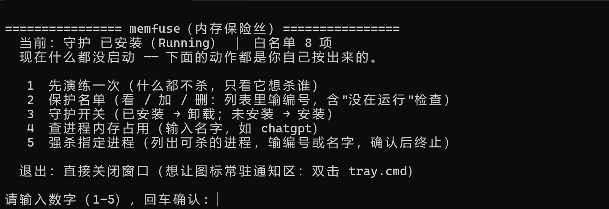
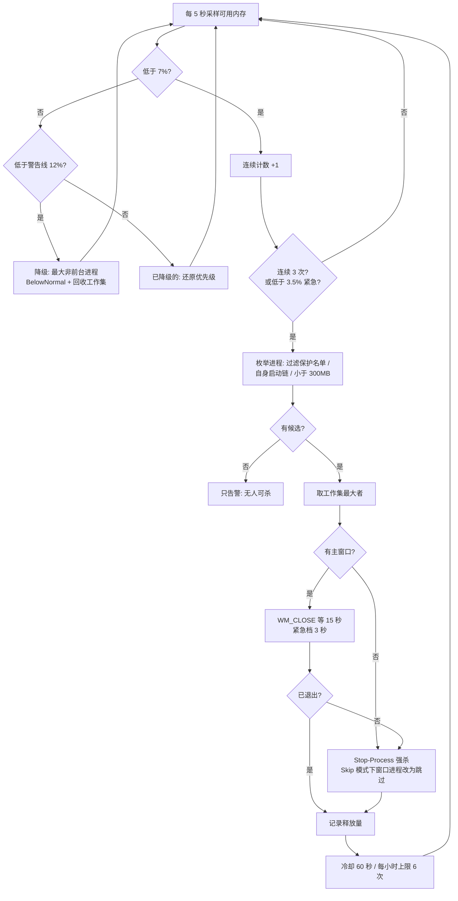
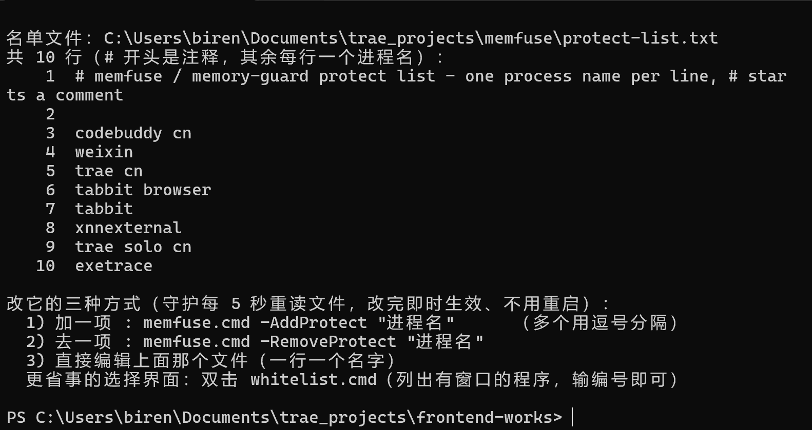
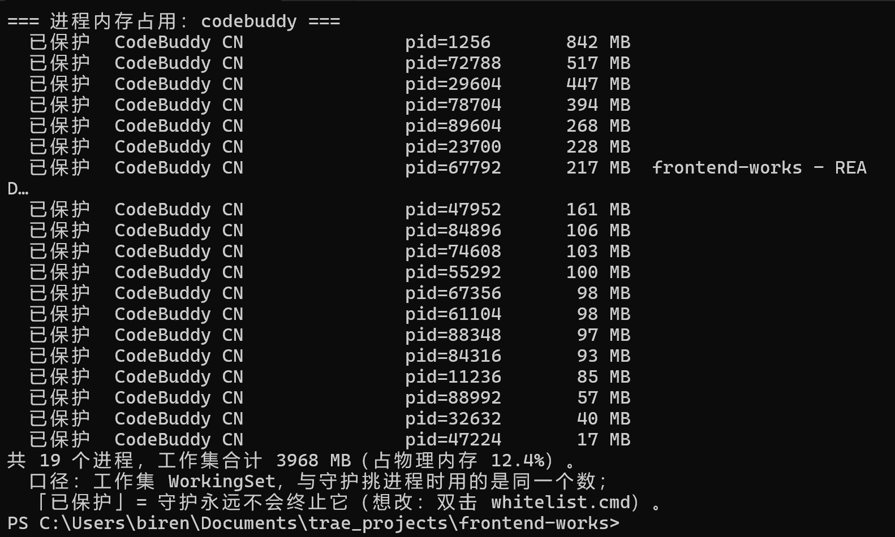

# memfuse（内存保险丝）


> **可用内存跌到临界、整机开始卡顿之前，先给最大的那个进程"降级"，真到临界才杀掉它**，把系统从悬崖边拉回来。
> 单文件 PowerShell（约 500 行），零依赖，克隆即用。**这是最后防线，不是内存优化器。**

<!-- README-SHOTS: N=9（功能点：自动守护 / 降级档 / 手动强杀 / 白名单 / 三档预设 / 托盘常驻 / 桌面快捷方式 / 查进程内存 / 交给 Agent 的 JSON 接口） -->

<p align="center">
  <br>
  <sub>主菜单（真机截图）：先看一行状态，再按数字选动作 —— 不想敲命令时，双击 <code>memfuse.cmd</code> 就是这一屏。</sub>
</p>

名字取自保险丝：它不阻止过载，只在过载时**牺牲最大的那一个，保住整条电路**。

---

## 一、定位声明：它是什么，不是什么

先把边界说清楚，免得选错工具：

- 它**不清理**缓存、**不压缩**内存、不提升任何性能；唯一的例外是**降级档**（见 §二-3）：在警告线以下，把**最大的非前台进程**的工作集交还系统（页仍可按需取回）——这是止损手段，不是"优化"；
- 它承认一个前提：**空闲内存是浪费的内存**（Windows 的内存管理哲学）。可用内存低本身不是病；
- 它只在一种场景下有意义：**机器被少数失控进程拖到临界，且你接受牺牲它们**；
- 代价必须写在最前面：被杀进程的未保存工作会丢。这不是"优化"，是**止损**。

### 与同类工具的关系

| 工具 | 它的做法 | 与本项目的关系 |
|---|---|---|
| 任务管理器（手动结束进程） | 你自己选、自己杀 | **卡死时你打不开它** —— 这正是本项目存在的原因 |
| Mem Reduct 等"清工作集"工具 | 让进程把内存交还系统，不杀进程 | 思路相容：本项目在**警告档**也会做一次（只针对最大的那个、且不动前台），但不做全局清工作集；失控时它仍然只有击杀 |
| "内存优化大师"类 | 清缓存 / 改注册表 / 宣称提速 | 不竞争：本项目不做任何"优化" |
| 页面文件 + 内存压缩（系统自带） | 系统级兜底 | 兜底的代价是全局换页卡顿；本项目在换页风暴**之前**动手 |
| 一堆 `auto-process-killer` 脚本 | 按阈值杀进程 | 差别不在"杀"，而在**守护者自身是否可靠**（见第四节） |

---

## 二、它怎么决策（四个问题）

### 1) 什么时候动手

| 级别 | 条件 | 动作 |
|---|---|---|
| WARN | 可用内存 < 12% | **降级，不杀**：最大的非前台进程 → `BelowNormal` + 回收工作集（10 分钟去抖；同一时刻只降一个，见 §二-3） |
| CRITICAL | 可用内存 < 7% **且连续 3 次采样**（5 秒一次） | 执行击杀（有窗口的先 `WM_CLOSE` 请它自己关） |
| EMERGENCY | 可用内存 < 3.5% | 立即执行、不等确认，且**放宽刹车**（冷却 3 秒、每小时上限 ×3，见 §二-3） |

"连续 3 次"是防抖：一次大分配、一次页面回收都会让单次读数越线。紧急通道是为"来不及等 15 秒"的雪崩场景留的——本机保留下来的 8 天日志里它被触发过 41 次，最低一次可用内存只剩 0.1%。

### 2) 动谁

按**工作集（Working Set）**降序取最大者，跳过小于 300MB 的进程。

300MB 地板的意义：如果连最大的进程都不到 300MB，说明内存不是被单进程吃掉的，杀谁都白杀——此时只告警，不动手。

#### 可选项 `-PreferIdle`：优先挑"你没在用的那个"

默认规则是"谁大杀谁"，它可能杀掉你正在看的浏览器。加上 `-PreferIdle` 后，选择改成**给体积打折**：

| 信号 | 怎么判定 | 折扣 |
|---|---|---|
| 前台窗口 | `GetForegroundWindow` 命中的进程（你此刻正在用的那个） | ×0.2 |
| 窗口已最小化 | `IsIconic` | ×0.7 |
| 近一个采样周期 CPU 在跑 | 与上一轮 CPU 时间差 ≥ 0.3 × `-IntervalSec` | ×0.7 |

**为什么折扣这么克制**：把内存腾出来仍是本职。折扣太狠的话，900MB 的忙碌进程会输给 500MB 的闲进程 —— 等于为了"不打扰"牺牲了效果。所以只有"前台"给硬折扣（那是你此刻在打字的应用），其余只是轻微降权，**体积仍是分数的主体**。

判定理由会写进日志，可逐条核对：

```text
candidates: CodeBuddy CN#26688=721MB[cpu-idle] | … | CodeBuddy CN#62840=730MB[cpu-busy] | …
DRY-RUN would kill CodeBuddy CN pid=26688 ws=721MB … reason=cpu-idle
```

一个必须说清的取舍：**忙碌的大进程可能因此不被选中**（排到靠后，甚至落在候选截断之外）。这正是该选项的语义 —— 优先"不打扰"，而不是"效果最大化"。要效果最大化，就别开它。

单元测试（不启动守护本体，用 AST 抽出打分函数来验）：`tests/victim-score.ps1`。

### 3) 怎么动

**还没到临界之前，先降级、不杀**：可用内存跌破警告线（默认 12%）时，守护会把**最大的非前台进程**降到 `BelowNormal` 优先级、并回收它的工作集（`EmptyWorkingSet`，把那部分物理内存还回去）；内存回到警告线以上、或 10 分钟后，自动还原优先级（页由进程自己按需取回）。它只在"警告~临界"这条带里工作——临界时照旧走下面的击杀流程。**同一时刻只降一个**（等信息恢复或持有到期再考虑下一个）——否则机器长期在 10–12% 徘徊时，一小时就能攒下一堆变慢的应用；节奏与持有上限由 `-DemoteCooldownSec`(120s) / `-DemoteHoldSec`(600s) 控制，`-NoDemote` 可整档关掉。**你正在看的那个应用（同名全家）永不降级**——含浏览器正在渲染你那一页的子进程（判定与豁免范围见 §二-4）。降级记录会**落盘**（`<LogDir>\demote-state.txt`）：守护重启（心跳自愈 / 发版重启 / 手动重启）后，新实例启动时自动把上一个实例搁下的进程还原——这是 2026-10-16 实测撞出来的缺陷（两个进程被搁在 `BelowNormal`），当天发现当天修。

先礼后兵，并留下证据：

1. 有主窗口的进程：先发 `WM_CLOSE`（等价于点窗口关闭按钮），给它 **15 秒**自己退出（紧急档只有 3 秒——没时间等人点保存）；
2. 超时或没有窗口：`Stop-Process -Force` 强杀；**若 `-WindowedAction Skip`，超时的窗口进程不会被强杀**，改试下一个候选；
3. 杀完等 3 秒，记录释放量（`before → after`）；
4. **每轮只杀一个**，冷却 60 秒；每小时最多 6 次。**紧急档例外**（可用内存 < 3.5%）：冷却压到 3 秒、上限放宽到 18 次/小时——机器要堵死的时候，"等这一小时过去"比"和重生进程互撕"更糟。

第 3、4 条是防雪崩的关键：杀一个、观察、再决定，而不是一次清场。没有频率刹车，反复的"杀-重生"会变成无限互撕。（演练 `-DryRun` 同样消耗刹车额度——预览才不会骗你。）

### 4) 谁不能杀

- **硬保护**：45 项系统关键进程（内核/会话、OS 基础设施、安全软件）+ 脚本自身启动链（防止守护把自己的终端一起杀掉）；
- **你正在看的那个应用全家豁免**（2026-10-16 起）：候选进程名 == 前台窗口所属进程名 → **跳过，不杀也不降级**。为什么按名字而不是按 pid——浏览器把窗口交给主进程，而你正在读的那一页跑在**同名的子进程**（renderer）里：只按 pid 判定，第一刀就会落在你眼前的标签页上（当天实测被杀两次）。切到后台它就恢复成候选；要**永久**保住它，仍然写 `protect-list.txt`；
- **软保护**：`protect-list.txt`，每行一个进程名；**运行期按修改时间重读**，`-AddProtect node,code` 或手改文件都即时生效，不用重启守护；
- **应用进程默认不保护**——这是策略选择，不是遗漏。保护名单不是技术问题，而是"谁有权决定杀掉用户的哪个程序"的问题：默认只硬保护"杀了会立刻蓝屏/注销/破坏系统"的最小集合，其余的取舍交还使用者。



---

## 三、真正的难点：守护者自己死了怎么办

一个"定时任务 + 杀进程"的脚本半小时能写完。难的是另一个问题：

> **当你需要它的时候，它还在不在？**

内存守护脚本最讽刺的失效方式是：某天系统真的卡死了，你去看日志——它三周前就悄悄退出了。

三层保障：

1. **开机自启**：登录时启动（`AtLogOn`）；
2. **心跳自愈**：一次性触发器 + **每 5 分钟无限重复**，配合 `MultipleInstances=IgnoreNew`（单实例）——守护活着时心跳是 no-op（不会起第二个实例）；它一旦死了，下一次心跳（≤5 分钟）自动把它拉回来；
3. **防被动停止**：`ExecutionTimeLimit=0`（永不超时终止）、电池模式不中断、失败自动重试 999 次。

自愈实测：手动杀掉守护进程（模拟崩溃）→ **4 分 46 秒后**新守护进程自动出现，全程无人工介入；同期间的心跳在守护存活时被正确忽略，没有出现第二个实例。

### 踩到的两个坑（PowerShell + 任务计划）

**坑一：`-RepetitionDuration` 不能是 `TimeSpan::MaxValue`。** 想当然地写"无限重复"，注册会直接失败：

```text
Register-ScheduledTask : The task XML contains a value which is
incorrectly formatted or out of range.
(10,42):Duration:P99999999DT23H59M59S
```

正解：**省略 `-RepetitionDuration` 参数**——空的 Duration 就表示无限重复。

**坑二：只用 `AtLogOn` 触发器时 `NextRunTime` 是空的。** 因为"已登录"状态下"下次登录"无法计算。改用"一次性触发器 + 重复间隔"作为心跳源后，`NextRunTime` 每 5 分钟正常滚动——"自愈是否在生效"从不可观察变成可观察。

---

## 四、真实战报（不是演示数据）

以下全部来自本机日志文件（2026-09-19 ~ 09-23，跨 5 天；日志按天滚动）：

| 指标 | 数值 |
|---|---|
| 成功终止进程 | **64 次** |
| 紧急通道触发（< 3.5%，不等 15 秒确认） | 10 次 |
| 候选被拒（access denied）→ 自动顺延下一个 | 9 次 |
| 每小时 6 次上限被真实拦住 | 17 次 |
| 被终止的最大进程 | **7.9 GB 工作集**（OneDrive.Sync.Service，8085 MB） |
| 单次最大观测释放 | **9.3 GB**（见下方口径说明） |
| 最低可用内存时刻 | **383 MB（1.2%）** |
| 累计观测释放 | ≈ 91 GB |

> 口径说明：`delta`（释放量）是"杀完 3 秒后可用内存的变化"，**不等于被杀进程的工作集**——进程退出会连带触发系统回收（缓存释放、其他进程缩容）。例如 09-22 21:19 终止的是一个 497MB 的进程，但可用内存回升了 9483MB。

三段原文摘录（已去掉本机路径）：

```text
# ① 极限时刻：可用内存只剩 1.2%
2026-09-20 10:45:20 CRITICAL(emergency) avail 383MB (1.2%) commit 67.9% total 32002MB
  - candidates: OneDrive.Sync.Service#16288=5946MB | Tabbit Browser#30496=1061MB | ...
2026-09-20 10:45:25 ACTION  stopped OneDrive.Sync.Service pid=16288
  - avail 383MB (1.2%) -> 8460MB (26.4%) [delta 8077MB]

# ② 候选被拒 → 自动顺延（第一名没权限，就试下一个）
2026-09-22 07:43:58 CRITICAL avail 1974MB (6.2%) commit 43.5% total 32002MB
  - candidates: MarvisKnowledgebase#14052=846MB | node#30552=794MB | ...
2026-09-22 07:43:59 ACTION  failed to stop MarvisKnowledgebase pid=14052 (access denied or still busy)
  - trying next candidate
2026-09-22 07:44:04 ACTION  stopped node pid=30552
  - avail 1974MB (6.2%) -> 2530MB (7.9%) [delta 556MB]

# ③ 频率刹车：没有它，反复的"杀-重生"会变成无限互撕
2026-09-22 08:05:08 LIMIT hourly kill limit reached (6/h) - not acting this round

# ④ 降级档（2026-10-16 新增，首次上线当天实录）
2026-10-16 15:04:07 WARN  avail 3090MB (9.7%) commit 74% total 32002MB  [warn<12% crit<7%]
2026-10-16 15:04:07 DEMOTE Tabbit Browser pid=49128 ws=357MB->357MB priority=BelowNormal + working set trimmed
2026-10-16 15:06:08 DEMOTE WorkBuddy pid=60444 ws=320MB->320MB priority=BelowNormal + working set trimmed
```

三个安全机制都不是"设计上写了"，而是**出厂前就被真实触发过**。④ 是降级档首次上线当天的实录——注意 `ws` 值没有下降：`EmptyWorkingSet` 交还的是 **standby 页**，工作集计数不即时反映；真正起作用的是"降优先级 + 那部分页变成随时可回收"。另外，同一台机器上 `OneDrive.Sync.Service` 在三天里三次涨到 4~8GB（09-20 / 09-22 / 09-23）——它处理的不是一次性事故，而是每天都会回来的病灶。

上线第一天的日志也值得留着：先干跑（`dryRun=True`），把阈值当实验调（35%/30% → 45%/40% → 12%/7%），确认"想杀的都是谁"之后才开火。**这个工具的第一个功能是演练模式。**

### 它的代价：我因此改了工作流

诚实比功能重要，说说它带来的真实麻烦：

1. **它杀过我正在跑的构建。** 09-22 16:28~16:34 的 6 分钟里终止了 5 个进程，其中 3 个是我正在跑的构建：`next build`、`tsc --noEmit`、`eslint` —— 构建期是内存峰值期，正好是它最想动手的时刻。应对不是放宽阈值（那等于让它在该动手时不动手），而是**本地不再跑构建，交给 CI**。
2. **它杀过 `git status -z -uall`。** 这个命令在 11 万文件的工作区能吃近 1GB（被终止 4 次，675~913MB，日志里都留着完整命令行）。这不是守护的错，但它让这个事实变得可见。
3. **提权进程杀不掉。** 微信、豆包等以更高权限运行的进程会返回 access denied（实测 9 次），脚本会自动顺延到下一个候选。想覆盖它们，脚本（或计划任务）必须同样以管理员身份运行。

---

## 五、已知局限（roadmap）

1. **判据单一：只看可用物理内存。** 真正接近"卡死"的信号其实是**提交内存（commit）压力**与硬错误页速率——本机高压时段 commit 一度到 **77%**。当前脚本把 commit **记录进日志**，但**没有纳入判定**。这是 roadmap，不是已完成特性。
2. **"杀进程"永远是最后手段**，不适用于日常内存管理（见第一节定位）。降级档是这条的折中：**能降就不杀**。
3. **杀叶子会被重生。** 日志里有一个反复被杀又反复回来的后台服务（Electron 主进程托管的 node gateway，被杀后 **9 秒**重生）：按内存排序只能选到叶子（真正吃内存的工作进程），而根进程往往只有一两百 MB，排在候选之外。**杀叶子=白杀（会被重生），杀根=有效（等于关掉用户整个应用）**——没有免费的午餐。
4. **不保证保存数据。** `WM_CLOSE` 只是替你点了关闭按钮，用户可能来不及保存；无窗口的后台进程直接强杀。
5. **只终止当前用户有权限终止的进程**，且不做任何"通知-等待-宽限"之外的协商。

---

## 六、快速开始

### 不想敲命令？（三步，全程只按数字）

1. **下载**：本页绿色按钮 `Code` → `Download ZIP`（或 Releases 页的 zip），解压到任意文件夹（放桌面就行，不需要安装任何东西）；
2. **双击 `memfuse.cmd`** → 出现数字菜单，按 `1` 先演练：什么都不杀，只告诉你"如果真动手，它会挑谁"；
3. 按 `2` 保护你在乎的程序（列表里输编号：微信、编辑器、CodeBuddy…… 选谁保护谁），再按 `3` 装上守护（**它顺手在桌面放一个「memfuse 内存保险丝」快捷方式**），然后关掉窗口 —— 完成。

菜单里还有 `2` 保护名单（看 / 加 / 删：列表里输编号，没在运行的条目会标出来）、`3` 守护开关（已安装 → 卸载；未安装 → 安装）、`4` 查进程内存占用（输个名字，如 `chatgpt`）、`5` 强杀指定进程（列表里输编号，确认后终止）；**退出 = 直接关闭窗口**。**白名单随时改**：双击桌面上那个快捷方式选 `2` 就行（也可以回来双击 `memfuse.cmd`，或 `whitelist.cmd`）。

**想让它常驻托盘？** 双击 `tray.cmd`：窗口消失，通知区出现一个图标；**双击图标直接打开菜单**；右键它能打开菜单 / 保护名单 / 名单文件 / 今天的日志 / 工具文件夹 —— **后三项都在命令行窗口里打开、窗口停在那儿不自动关**（可以滚动、可以复制，也能直接接着敲 `-AddProtect` / `-RemoveProtect` 改名单）；鼠标悬停显示实时可用内存百分比。**关掉窗口它在** —— 控制台的 X 无法被取消（Windows 一定会结束那个进程），所以实现方式是"立刻以隐藏方式把自己重新拉起"，托盘与守护都继续。

> 三个细节：① `memfuse.cmd` 自带 `-ExecutionPolicy Bypass` 启动脚本，所以"新下载的脚本被 Windows 拦住"不会发生；② 安装守护不需要管理员权限；③ **快捷方式是"在你电脑上现建"的**——.lnk 里存的是绝对路径，随 zip 附带的必然是死链（指向打包者的机器），所以只能由脚本生成。卸载会一并删掉它；若你把文件夹搬了家、快捷方式失效，重新双击 `memfuse.cmd` 按 `3` 即可重建。

### 想敲命令？（等价写法）

```powershell
# 0) 先演练：什么都不杀，只告诉你会杀谁（强烈建议先跑几天）
powershell -NoProfile -ExecutionPolicy Bypass -File .\memory-guard.ps1 -Once -DryRun
powershell -NoProfile -ExecutionPolicy Bypass -File .\memory-guard.ps1 -DryRun -Verbose

# 1) 前台正式运行
powershell -NoProfile -ExecutionPolicy Bypass -File .\memory-guard.ps1

# 2) 注册守护任务（登录自启 + 5 分钟心跳自愈；不需要管理员）
powershell -NoProfile -ExecutionPolicy Bypass -File .\memory-guard.ps1 -InstallTask

# 3) 卸载
powershell -NoProfile -ExecutionPolicy Bypass -File .\memory-guard.ps1 -UninstallTask

# 4) 白名单：最省事的做法是「双击 whitelist.cmd」——看列表、输入编号即可
#    命令行等价写法：
powershell -NoProfile -ExecutionPolicy Bypass -File .\memory-guard.ps1 -Pick
powershell -NoProfile -ExecutionPolicy Bypass -File .\memory-guard.ps1 -AddProtect 微信,Code
powershell -NoProfile -ExecutionPolicy Bypass -File .\memory-guard.ps1 -RemoveProtect 微信

# 4.5) 桌面快捷方式（装守护时自动创建；文件夹搬家后可用这两条重建 / 删除）
powershell -NoProfile -ExecutionPolicy Bypass -File .\memory-guard.ps1 -CreateShortcut
powershell -NoProfile -ExecutionPolicy Bypass -File .\memory-guard.ps1 -RemoveShortcut

# 4.6) 托盘模式：窗口隐藏，通知区图标常驻（关掉窗口它会重新拉起自己）
powershell -NoProfile -WindowStyle Hidden -ExecutionPolicy Bypass -File .\memory-guard.ps1 -Tray

# 4.7) 查指定进程占多少内存（名字大小写无所谓；支持通配符 chat*、一次多个 code,node）
powershell -NoProfile -ExecutionPolicy Bypass -File .\memory-guard.ps1 -ShowProcMem chatgpt

# 4.8) 手动强杀指定进程：列出可杀的带窗口进程，输编号或名字，输 y 确认后终止
powershell -NoProfile -ExecutionPolicy Bypass -File .\memory-guard.ps1 -KillProc
powershell -NoProfile -ExecutionPolicy Bypass -File .\memory-guard.ps1 -KillProc -KillProcInput "1;y"   # 脚本化：选 1 号并确认

# 4.9) 看日志 / 看名单文件（托盘右键的「看今天的日志 / 编辑名单文件」就是这两条，只是额外套了个不会自动关的窗口）
powershell -NoProfile -ExecutionPolicy Bypass -File .\memory-guard.ps1 -ShowLog            # 今天日志的最新 60 行（-LogTail 20 可改行数）
powershell -NoProfile -ExecutionPolicy Bypass -File .\memory-guard.ps1 -ShowProtectFile    # 名单文件：路径 + 带行号的内容 + 三种改法

# 5) 不想维护名单？用三档预设选一个策略（见下）
powershell -NoProfile -ExecutionPolicy Bypass -File .\memory-guard.ps1 -Preset safe -InstallTask
```

### 三档预设（记不住参数就记这三个词）

| 预设 | 含义 | 适合谁 |
|---|---|---|
| `-Preset safe` | **有窗口的程序一律不杀**（`Skip` + 宽限期 30 秒） | 数据优先：宁可机器紧一会儿，也不要丢未保存的工作 |
| `-Preset balanced` | 先请它自己关（`WM_CLOSE`），等不到再强杀（默认） | 大多数人的默认选择 |
| `-Preset aggressive` | 直接强杀（`Force`） | 机器优先：卡死比丢数据更难受 |

全部参数（默认值见括号）：`-WarnPercent`(12) `-CriticalPercent`(7) `-SustainSamples`(3) `-IntervalSec`(5) `-CooldownSec`(60) `-EmergencyCooldownSec`(3) `-MinCandidateMB`(300) `-MaxKillsPerHour`(6) `-NoDemote` `-DemoteCooldownSec`(120) `-DemoteHoldSec`(600) `-GracefulSeconds`(15) `-WindowedAction`(Close) `-Preset`(safe/balanced/aggressive) `-Protect node,code` `-ProtectFile .\protect-list.txt` `-AddProtect` `-RemoveProtect` `-Pick` `-ShowProcMem <名字>` `-KillProc` `-KillProcInput "1;y"` `-ShowProtectFile` `-ShowLog` `-LogTail`(60)

【查看类】`-ListProtected`（现有名单，含"当前未运行"标注）`-ShowProtectFile`（名单文件的路径、带行号的内容与三种改法）`-ShowLog`（今天日志的最新 N 行，`-LogTail` 改行数）`-ListWindowed`（谁有窗口）`-ShowProcMem chatgpt`（查指定进程占多少内存：每个匹配进程的工作集/标题/受保护状态 + 合计与占物理内存比；支持通配符 `chat*` 与一次多个 `code,node`）`-Help`（中文用法）`-Menu`（数字菜单，等同双击 `memfuse.cmd`）`-PreferIdle`（优先挑未在使用的进程，见下）`-DryRun` `-Once` `-NoSelfProtect`

【快捷方式】`-CreateShortcut`（在桌面放一个回到菜单的快捷方式；`-InstallTask` 会顺手做）`-RemoveShortcut`（删掉它）

【机器可读】`-Json [-OutFile <路径>]`（状态 JSON：内存采样 / 档位 / 阈值 / **当前候选** / 已降级 / 白名单 / 日志尾部——**只读**，不杀不降级不改名单）`-AgentGuide [-OutFile <路径>]`（生成「交给 Agent」的接口说明，整段转发给任意 AI Agent）

### 界面（两张真机截图）

<p align="center">
  <br>
  <sub>名单就是一张文本表（真机截图）：每行一个进程名，改完 5 秒内生效、不用重启；三种改法都印在同一屏。</sub>
</p>

<p align="center">
  <br>
  <sub>查指定进程占多少内存（真机截图）：同名进程逐个列出 pid 与工作集，并标出「已保护」——这些永远不会被终止。</sub>
</p>

### 交给 Agent：只读状态 JSON + 交接说明（2026-10-17）

守护的决策（谁被降级、现在谁是候选）原本只活在进程内存和给人看的日志里——外部 Agent 拿不到，也就答不出"刚才为什么杀了 X"。两个开关把它变成可读接口：

```powershell
# 状态 JSON：schema memfuse.status v1（UTF-8 带 BOM 落盘）
powershell -NoProfile -ExecutionPolicy Bypass -File .\memory-guard.ps1 -Json -OutFile status.json

# 接口说明（Markdown）：整段复制/转发给任意 Agent，它即按契约调用
powershell -NoProfile -ExecutionPolicy Bypass -File .\memory-guard.ps1 -AgentGuide -OutFile agent-guide.md
```

JSON 关键字段：`memory`（`freeMB` / `freePercent` / `commitPercent`）· `tier`（`healthy` / `warn` / `critical`）· `thresholds`（各档阈值与开关）· `candidates[]`（**当前会动手的候选**，已排除白名单与"你正在看的应用"及其同名子进程）· `demoted[]`（被降级还没还原的）· `protected`（内置 + 名单条目）· `todayLog.tail`（今天日志尾部）。

两条纪律：**读路径只读**——`-Json` / `-AgentGuide` 不杀进程、不降级、不改名单（自测里用前后哈希断言了这一点）；中文一律走 `-OutFile` 落盘，不要依赖 stdout 的编码（Windows 控制台默认 GBK，管道里会把中文写坏）。

与 [ExeTrace](https://github.com/joker1point/ExeTrace) 联动：装了原生版（≥ v1.1.0）后可在它的应用列表里右键「加入 memfuse 白名单」，CLI 等价写法 `ExeTrace.exe --whitelist "<进程名或 exe 路径>"`——那条路调的就是本脚本的 `-AddProtect`（同一套幂等写入，不存在第二份名单逻辑）。

【托盘】`-Tray`（窗口隐藏 + 通知区图标：右键打开菜单 / 保护名单 / 名单文件 / 今天的日志 / 工具文件夹 —— **后三项是命令行窗口、停住不自动关**；悬停看实时可用内存；关掉窗口也不丢，会以隐藏方式把自己重新拉起）

【白名单的三种改法】① 双击 `whitelist.cmd`（推荐，选编号）；② `-Pick`（同上的命令行版）；③ 直接编辑 `protect-list.txt`（每行一个进程名）。**三种都立即生效，不用重启守护**；写错名字会有明确提示，不会静默失效。

文件：

```text
memory-guard.ps1        主脚本（单文件；文件名保持与本机实测版本一致，未随仓库改名）
protect-list.sample.txt 保护名单样本 → 复制为 protect-list.txt 使用
logs\memory-guard-YYYYMMDD.log   运行日志
<桌面>\memory-guard-alert.txt    每次动手后的留档：杀了谁、前后可用内存、路径、完整命令行、如何把它加进保护名单
```

采样用 `Add-Type` P/Invoke 直读 kernel32 的 `GlobalMemoryStatusEx`：不起子进程、不调 CIM，**零依赖**（不需要 Python / psutil / .NET SDK），单次采样成本近乎为零。

---

### 在一台新机器上第一次运行

依赖层面是零依赖：只需要 Windows 10/11 自带的 PowerShell 5.1，**不需要 Python / .NET SDK / 管理员权限**，干净目录里放一个 `.ps1` 就能跑（运行期只多一个 `logs\` 目录，白名单文件可以不存在）。

但 Windows 对新下载的脚本有两道闸，先过闸再跑：

| 你会看到的报错 | 原因 | 处理 |
|---|---|---|
| `... is not digitally signed. You cannot run this script on the current system.` | 文件带"来自 Internet"标记（Mark-of-the-Web），而策略是 `RemoteSigned` | 用仓库里的 **`memfuse.cmd`** 启动（内部已带 `-ExecutionPolicy Bypass`），或先 `Unblock-File .\memory-guard.ps1` |
| `... cannot be loaded because running scripts is disabled on this system.` | Windows 客户端出厂默认策略 `Restricted` | 同上：`memfuse.cmd`，或显式 `-ExecutionPolicy Bypass`，或 `Set-ExecutionPolicy -Scope Process Bypass` |

`git clone` 过来的文件不带 Mark-of-the-Web，只需处理策略那一行。**两种闸都不需要改机器全局策略**——`memfuse.cmd` 与文档里的 `-ExecutionPolicy Bypass` 都是按次生效的。

第一步永远先演练（不杀任何东西）：

```bat
memfuse.cmd -Once -DryRun
memfuse.cmd -ListWindowed
memfuse.cmd -InstallTask
```

`-InstallTask` 不需要管理员；若企业策略禁止注册计划任务，它会打印 `ERROR  task registration failed: ...` 并退出，不会静默失败。

### 复现验证

`-WindowedAction` 的两种语义有可复现的端到端测试（不是看代码，是做实验）：

```powershell
powershell -NoProfile -ExecutionPolicy Bypass -File .\tests\windowed-protection.ps1
```

它会起一个**主动忽略关闭请求**的窗口进程（tkinter，约 250MB），再用临时白名单把机器上其余进程名全部保护起来——于是守护只剩这一个候选：`Skip` 阶段断言它存活，`Close` 阶段断言它被强杀。测试不需要管理员，不碰仓库里的 `protect-list.txt`，日志落在 `%TEMP%`，桌面告警文件测前备份、测后还原。没有 Python（含 tkinter）时它会干净地输出 `[SKIP]` 退出。

## 七、安全警告

- **先 `-DryRun` 跑几天**，看清"它想杀的都是谁"，再决定是否开火。
- 它**真的会杀掉你的程序，未保存的工作会丢**。默认保护名单只保证"不会杀掉让系统蓝屏/注销/破坏安全软件"的最小集合——**你的应用进程不在保护范围内**。
- 想保住某个进程，写进 `protect-list.txt`（或 `-AddProtect <name>`）；代价是：它也可能正是内存临界时最大的那个占用者。
- **它也会给你的后台大进程"降级"**（警告档就开始了，见 §二-1 / §二-3）：降优先级 + 回收工作集，**不杀、不丢数据**，内存转好或 10 分钟后自动还原；**前台窗口的进程永远不降级**。不想让它这么做：`-NoDemote`。
- **在乎未保存的工作？三条路，从轻到重**：① **双击 `whitelist.cmd`**（或 `-Pick`）看清谁握着窗口，输入编号即保护；② 直接用 `-Preset safe`：有窗口的进程一律不强杀（代价是机器可能仍然很紧，几乎不用维护名单）；③ 调大 `GracefulSeconds`（默认 15 秒），给"保存 / 放弃"对话框更多时间。紧急档（可用内存 < 3.5%）只有 3 秒——那是最坏情况下的取舍，写在明处。
- 默认只在你自己的权限范围内生效；以管理员身份运行 = 它也能杀提权进程，请自行评估。
- **手动强杀**（`-KillProc` / 菜单第 5 项）是另一条路，别混淆：列表只含"可杀"的进程——系统关键进程与白名单进程不在列表里，手输它们的名字也会被拒绝；每次终止都必须输 `y` 确认（脚本化时确认写进 `-KillProcInput "1;y"` 的分号后面，漏写 = 不杀）。仍在响应的有窗口进程会先收到关闭请求（宽限期同守护），已卡死（无响应）或没有窗口的直接终止——卡死的进程本来也收不到关闭请求，等 15 秒只是浪费你的时间。**它不受每小时 6 次的刹车限制**：那是守护的自我保护，不是你的。每次手动终止都写进当天日志（`MANUAL` 关键词，含路径与完整命令行）。

---

## 八、进一步阅读

- 设计复盘（含"守护者自身的可靠性"、策略三次反转、杀-重生循环根因）：[最后一道内存防线：内存守护脚本的设计取舍与真实战报](https://joker1point.github.io/techlog/blog/memory-guard-last-line-of-defense)
- 姊妹项目：[portwatch](https://github.com/joker1point/portwatch)（谁占着端口）、[flowwatch](https://github.com/joker1point/flowwatch)（谁在用带宽）——同一套本地可观测性思路的三个切面。
- 维护者交接（发版流程 / 部署状态与回滚 / 修改红线）：[docs/handoff.md](docs/handoff.md)

## License

MIT
